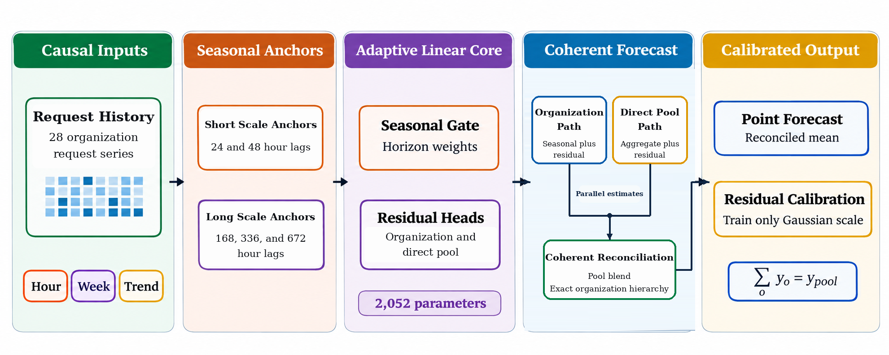
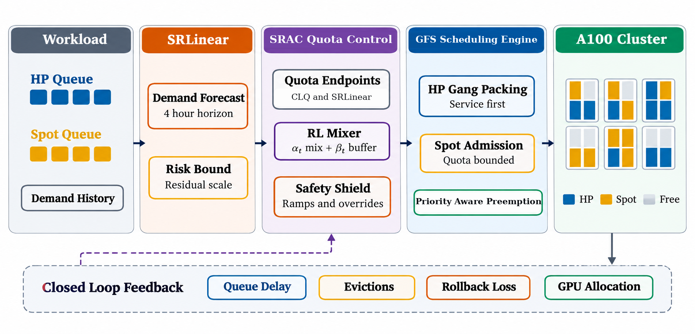
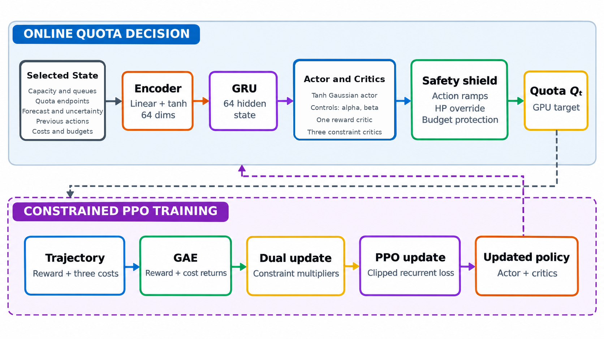

# SRLinear and SRAC GPU Scheduling:

This repository contains the code used for the validation results in the paper **Forecast Guided Reinforcement Learning for Reliable and Risk Aware Quota Control in Preemptible GPU Scheduling**.

The project studies preemptible Spot scheduling on the Alibaba A100 GPU trace. SRLinear provides a small coherent demand forecaster. SRAC uses constrained recurrent proximal policy optimization to choose a quota mixture and an uncertainty deduction under service and rollback budgets.

## Authors:

- Mridankan Mandal.
- Dhannu Ram Meena.
- Shreyans Jain.

## Main methods:

- **SRLinear:** A 2,052 parameter causal forecaster. It combines daily and weekly seasonal anchors, small residual heads, a direct pool estimate, and exact organization reconciliation.
- **SRGFS:** Native GFS scheduling with the OrgLinear forecast replaced by SRLinear.
- **SRAC:** A recurrent constrained quota controller. It mixes Contextual Linear Quota and SRLinear quota endpoints, then applies a bounded uncertainty deduction and a safety shield.

## Method overview:



**Figure 1.** SRLinear forecasting architecture.



**Figure 2.** Forecast guided quota control and GFS scheduling framework.



**Figure 3.** SRAC recurrent actor critic and constrained PPO training loop.

## Reported validation results:

The chronological protocol uses May and June for training and July for validation. August remains locked for final testing.

| Result | Measured value |
| --- | ---: |
| SRLinear mean absolute error | 154.964 GPUs |
| SRLinear parameters | 2,052 |
| SRLinear multiply accumulate operations | 10.372 thousand |
| SRLinear speed gain over PatchTST | 19.39 times |
| SRGFS useful Spot work gain over Native GFS | 0.256 percent |
| SRGFS Spot queue reduction over Native GFS | 85.6 percent |
| SRAC useful work retained relative to Contextual Linear Quota | 99.9507 percent |
| SRAC rollback loss reduction | 2.97 percent |
| SRAC eviction reduction | 4.76 percent |

These are validation results from the fixed A100 protocol. They are not final test results and are not independent reproductions of external papers.

## Repository map:

- `environment/` contains the common event simulator, GFS code, split configs, schemas, and integrity checks.
- `methods/forecasters/` contains SRLinear and the reported forecasting baselines.
- `methods/quota_rl/` contains the SRAC environment, recurrent actor critic, and constrained PPO implementation.
- `benchmark/` contains final experiment suites, runners, metrics, fit commands, and seed control.
- `tests/` contains focused checks for the released simulator and final methods.
- `data/` contains trace acquisition and hash instructions. Raw trace files are excluded.
- `paper/` contains the LaTeX source, final PDF, and required figures.
- `docs/` contains method, data, licensing, and reproduction notes.
- `CodeBaseIndex.md` maps each release component to its role.

## Data protocol:

Download the [Alibaba GPU Spot Trace](https://github.com/alibaba/clusterdata/tree/master/cluster-trace-v2026-spot-gpu) from the official Alibaba Cluster Trace Program repository. Detailed acquisition and hash verification instructions are provided in [data/README.md](data/README.md). Place the two verified files at:

```text
data/raw/spot_gpu_v2026/node_info_df.csv
data/raw/spot_gpu_v2026/job_info_df.csv
```

The protocol accepts only the recorded hashes. Primary experiments use `A100-SXM4-80GB` nodes and natural one times Spot arrivals.

| Role | Calendar interval |
| --- | --- |
| Warmup | 1 March to 30 April 2024. |
| Train | 1 May to 30 June 2024. |
| Validation | 2 July to 31 July 2024. |
| Test | 2 August to 31 August 2024. |

One day is embargoed between adjacent scored splits.

## Runtime setup:

Run all research commands inside WSL and a project Conda environment. The checked specifications do not install into Conda `base`.

```bash
cd /mnt/c/path/to/SRLinearRLGPUScheduler
conda env create -f environment.yml
conda run --no-capture-output -n iml-research-rmproject python -m pip install -e .
```

CUDA users can create the environment from `environment-gpu.yml`. Temporal Mamba requires the separate exact specification in `benchmark/forecast_environment.lock.yml`.

## Verification:

Run integrity, import, and unit checks before any experiment:

```bash
conda run --no-capture-output -n iml-research-rmproject python environment/tools/verify_freeze.py
conda run --no-capture-output -n iml-research-rmproject python -m pytest -q
conda run --no-capture-output -n iml-research-rmproject python benchmark/run.py --suite benchmark/non_rl_suite.yaml list
conda run --no-capture-output -n iml-research-rmproject python benchmark/rl_run.py --suite benchmark/srac_rl_suite.yaml list
```

Generate local warmup snapshots after the trace has been verified:

```bash
conda run --no-capture-output -n iml-research-rmproject python environment/tools/generate_snapshots.py environment/configs/natural_train.yaml environment/configs/natural_val.yaml
```

Snapshots, fitted controls, logs, checkpoints, and result JSON files are generated locally and are not tracked by Git.

## Forecast experiments:

First run a bounded smoke check:

```bash
conda run --no-capture-output -n iml-research-rmproject python benchmark/forecast_run.py --models seasonal_naive,dlinear,nlinear,srlinear,patchtst,orglinear_released smoke
```

Run the complete development benchmark only after the smoke check passes:

```bash
conda run --no-capture-output -n iml-research-rmproject python benchmark/forecast_run.py --models seasonal_naive,dlinear,nlinear,srlinear,patchtst,orglinear_released run
```

The Temporal Mamba control is run separately in the Mamba environment:

```bash
conda run --no-capture-output -n mambahar python benchmark/forecast_run.py --models temporal_mamba run
```

## Scheduling experiments:

The deterministic baseline suite is prepared and launched with:

```bash
conda run --no-capture-output -n iml-research-rmproject python benchmark/experiments.py --plan benchmark/paper_scheduler_plan.yaml prepare
conda run --no-capture-output -n iml-research-rmproject python benchmark/experiments.py --plan benchmark/paper_scheduler_plan.yaml launch --split val
```

SRLinear calibration and contextual controls must be fitted only from training outputs. The exact fit tools are:

```bash
python benchmark/fit_srlinear_quota_calibration.py --forecast-batch <train forecast batch> --output benchmark/fitted/srlinear_quota_calibration.json
python benchmark/fit_contextual_control.py --train-report <train replay report> --output benchmark/fitted/non_rl_contextual_linear.json --qualification publication
python benchmark/fit_srgfs.py --contextual benchmark/fitted/non_rl_contextual_linear.json --output-dir benchmark/fitted
```

Fit every deterministic quota control reported in the paper from the same training replay:

```bash
conda run --no-capture-output -n iml-research-rmproject python benchmark/fit_paper_controls.py \
  --train-report <complete train quota report> \
  --output-dir benchmark/fitted \
  --qualification publication
```

This command produces the Fixed Residual Quota, Diurnal Quota Control, Online Quantile Control, Headroom Reserve Control, Contextual Linear Quota, and SRQGuard control artifacts. Validation and test outcomes are rejected as fit inputs.

Prepare and launch the complete non RL comparison and SRQGuard ablation plan:

```bash
conda run --no-capture-output -n iml-research-rmproject python benchmark/experiments.py \
  --plan benchmark/paper_non_rl_plan.yaml prepare
conda run --no-capture-output -n iml-research-rmproject python benchmark/experiments.py \
  --plan benchmark/paper_non_rl_plan.yaml launch --split val
```

Run those Python commands through `conda run` inside WSL. Fitted JSON files remain local artifacts because they encode outputs of the training stage.

## SRAC experiments:

SRAC uses three random seeds derived at run time from master seed 17. Run a bounded smoke test before the full validation batch:

```bash
conda run --no-capture-output -n iml-research-rmproject python benchmark/rl_run.py --suite benchmark/srac_rl_suite.yaml smoke --train-steps 16 --eval-steps 16
conda run --no-capture-output -n iml-research-rmproject python benchmark/rl_experiments.py --suite benchmark/srac_rl_suite.yaml prepare
conda run --no-capture-output -n iml-research-rmproject python benchmark/rl_experiments.py --suite benchmark/srac_rl_suite.yaml launch
```

The runner records the code commit, config hashes, trace hashes, split, seed, runtime environment, actions, metrics, and checkpoints for each run.

## Paper result map:

[`benchmark/paper_results_manifest.yaml`](benchmark/paper_results_manifest.yaml) is the source of truth that maps each paper label to its suite and executable method identifier. It covers these result groups:

- Forecasting baselines and SRLinear.
- Native GFS and scheduler baselines.
- Deterministic quota controls, SRGFS, and SRMix.
- CLQ PPO, SRU PPO, SRQ PPO, and SRAC.
- Every reported SRQGuard ablation.

The literature scheduler controls are declared in `benchmark/suite.yaml`. The quota controls and mechanism ablations are declared in `benchmark/non_rl_suite.yaml`. The RL controls are declared in `benchmark/rl_suite.yaml`, `benchmark/srlinear_rl_suite.yaml`, and `benchmark/srac_rl_suite.yaml`.

Aggregate completed runs without copying large artifacts into Git:

```bash
conda run --no-capture-output -n iml-research-rmproject python \
  benchmark/aggregate_paper_results.py \
  --input CLQ=<path/to/publication_metrics.json> \
  --input SRAC=<path/to/validation.json> \
  --output runs/paper_summary.csv
```

Repeat `--input METHOD=PATH` for every seed. The aggregator rejects incomplete observations and reports the mean and sample standard deviation used by the paper tables.

## Paper build:

The checked PDF is available at [paper/main.pdf](paper/main.pdf). Rebuild it with:

```bash
cd paper
bash build.sh
```

Regenerate all paper figures after the full result runs complete:

```bash
SRAC_VALIDATION_JSON=<path/to/completed/validation.json> \
conda run --no-capture-output -n iml-research-rmproject python \
  paper/scripts/build_research_figures.py
```

Figures 1 to 3 are deterministically corrected and packaged from the retained source images under `paper/figure_sources/`. Figures 4 to 7 encode the verified paper table values. Figure 8 reads the complete SRAC action ledger named by `SRAC_VALIDATION_JSON`.

## Reproducibility boundary:

- Raw trace data is not redistributed.
- Large snapshots, fitted artifacts, logs, and checkpoints are not committed.
- All published validation metrics require the official trace and complete replay time.
- The August final test split remains locked in this release.
- Local code and output consistency tests are included. Full numerical reproduction still requires rerunning the documented experiments.
- No reported run artifact is stored in Git. Every reported method definition, fit rule, runner, metric reducer, and paper label mapping is stored in Git.

## License:

The repository is released under GNU General Public License version 3. The GFS derived code retains its original license notice under `environment/src/research_sim/gfs/LICENSE`.
